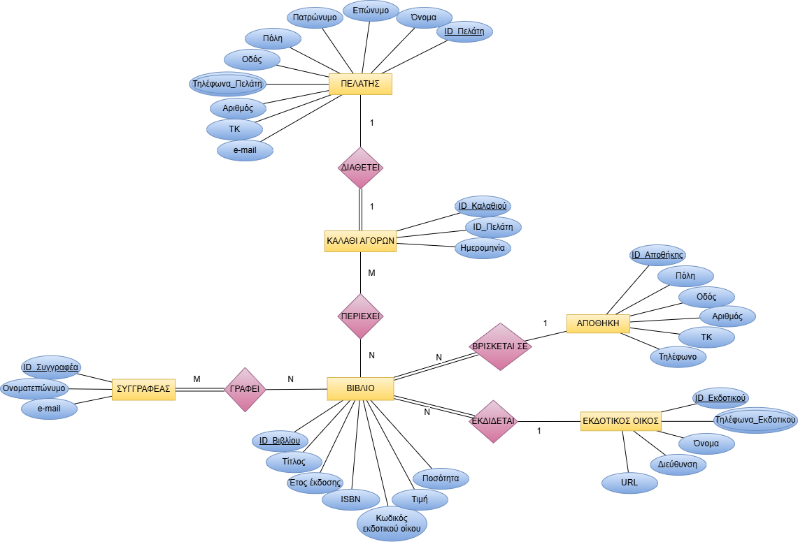
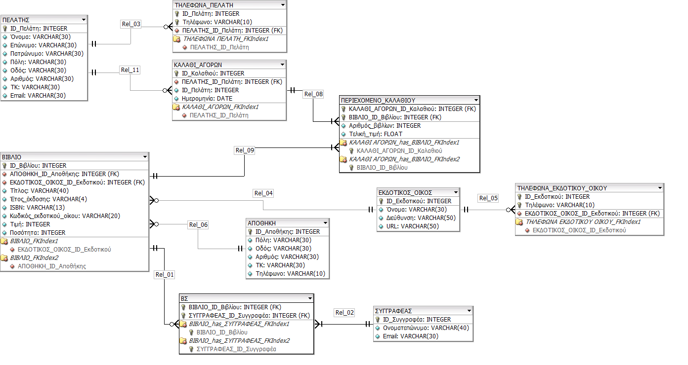

# E-commerce Bookstore Database
> A relational database design and SQL implementation for a comprehensive electronic bookstore system.

## Tech Stack & Design Tools
- **Language:** SQL (Data Definition Language)
- **Database Model:** Relational Database
- **Design Tools:** draw.io (for ER Modeling)

## Architecture & Schemas

### 1. Conceptual Schema (ER Diagram)
The database was initially mapped out using an Entity-Relationship diagram, defining the core entities (Customer, Book, Author, Publisher, Warehouse) and their relationships.

### 2. Logical Schema (Relational Model)
The ER diagram was translated into a relational schema. This structure ensures referential integrity using primary and foreign keys, supporting complex features like shopping carts (`ΚΑΛΑΘΙ_ΑΓΟΡΩΝ`) and many-to-many relationships between authors and books (`ΒΣ`).

## How to Use
1. Clone this repository:
   `git clone https://github.com/eftihia5/Bookstore-SQL-Database.git`
2. Open your preferred SQL IDE (e.g., MySQL Workbench, DBeaver, SQL Server Management Studio).
3. Connect to your local database server.
4. Execute the `project_SQL.sql` file to create the tables, indexes, and relationships.
